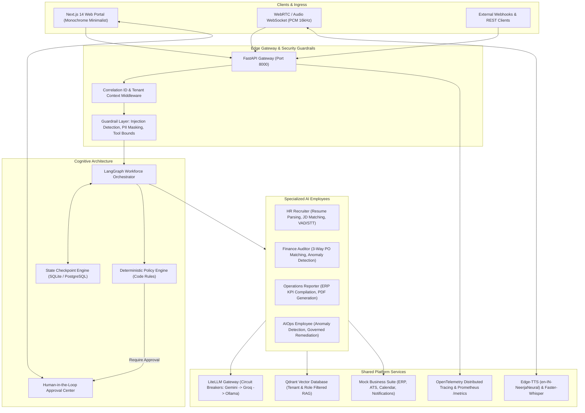

# AgentForce AI

> **"Create AI Employees, Not AI Chatbots."** — The Enterprise Operating System for Governed AI Workforces.

AgentForce AI is an enterprise-grade, multi-tenant SaaS platform that enables organizations to deploy, manage, and govern digital AI employees across specialized domains—including **HR Talent Acquisition**, **Finance & Invoice Auditing**, **Operations & Executive Reporting**, and **AIOps Self-Healing Infrastructure**—with deterministic human-in-the-loop governance, voice interaction, and multi-tenant vector memory.

---

## Architecture



### Core Architecture Principles
1. **Deterministic Governance:** Pure code rules dictate sensitive action execution. Silence, timeouts, or LLM hallucinations are never interpreted as authorization.
2. **Strict Multi-Tenancy:** Every database query, vector search, audit record, and cache key is partitioned by `tenant_id`.
3. **No Direct Agent-to-Agent Mesh:** All multi-agent workflows pass through the centralized Workforce Orchestrator or the event bus.
4. **Idempotent Tool Execution:** All external tool calls require idempotency keys and are logged in immutable audit tables.
5. **Failover Resilience:** The LLM gateway uses circuit breakers with multi-provider fallbacks (`Gemini` → `Groq` → `Ollama`).
6. **Monochrome Minimalist Design:** High-contrast black, white, and neutral gray design system with zero gradients, zero heavy shadows, and full dark/light mode support.

---

## Monorepo Directory Structure

```
agentforce-ai/
├── README.md                           # Master system documentation & demo guide
├── .env.example                        # Comprehensive environment template
├── docker-compose.yml                  # Infrastructure services (Redis, Qdrant, RabbitMQ)
├── docker-compose.observability.yml    # Telemetry stack (OTel, Prometheus, Grafana, Loki)
├── k8s/                                # Kubernetes production manifests
│   ├── namespace.yaml                  # 'agentforce' namespace
│   ├── configmap.yaml                  # Non-sensitive runtime configuration
│   ├── secrets.yaml                    # Production credential placeholders
│   ├── redis-deployment.yaml           # Redis cache deployment & service
│   ├── backend-deployment.yaml         # FastAPI deployment, probes & service
│   ├── frontend-deployment.yaml        # Next.js deployment & service
│   └── ingress.yaml                    # NGINX ingress routing /api, /metrics, and /
├── .github/workflows/
│   └── ci.yml                          # GitHub Actions CI (lint, backend test, frontend build)
├── frontend/                           # Next.js 14 App Router (Tailwind CSS, Lucide icons)
│   ├── app/
│   │   ├── page.tsx                    # Landing / Overview page
│   │   ├── dashboard/                  # Multi-agent operations dashboard
│   │   ├── workflows/                  # Workflow timeline, SSE streaming & execution
│   │   ├── employees/                  # AI Employees roster & Marketplace template installer
│   │   ├── approvals/                  # Human-in-the-Loop governance approval center
│   │   ├── knowledge/                  # Document ingestion & Qdrant vector memory search
│   │   ├── analytics/                  # LLM token costs, latency & error rate analytics
│   │   ├── aiops/                      # Self-healing incident monitoring & governed remediation
│   │   ├── audit-logs/                 # Immutable compliance trail & RFC 4180 CSV export
│   │   ├── voice/                      # Real-time WebRTC/WebSocket Voice AI assistant
│   │   ├── integrations/               # ERP, ATS, Calendar, and Payment connectors
│   │   ├── settings/                   # Organization settings & token budget controls
│   │   └── login/                      # Tenant authentication portal
│   ├── components/                     # Header, Sidebar, ThemeToggle, AudioVisualizer
│   └── styles/globals.css              # Monochrome minimalist design tokens
└── backend/                            # FastAPI Python 3.12 Backend
    ├── app/
    │   ├── main.py                     # Entrypoint, CORS, correlation middleware, error handlers
    │   ├── core/                       # Config, security, DB engine, logging, telemetry
    │   ├── models/                     # SQLAlchemy ORM models (Postgres / SQLite)
    │   ├── schemas/                    # Pydantic schemas & response contracts
    │   ├── api/v1/                     # REST API routers (Workflows, Approvals, Voice, AIOps, etc.)
    │   └── services/
    │       ├── agents/                 # Specialized employees: HR, Finance, Operations, AIOps
    │       ├── approvals/              # Human-in-the-loop lifecycle & LangGraph resumption
    │       ├── guardrails/             # Injection guard, PII redactor, tool boundary validator
    │       ├── llm_gateway/            # LiteLLM routing, circuit breaker, failover chains
    │       ├── memory/                 # Ingestion, chunking, and Qdrant vector search
    │       ├── orchestrator/           # LangGraph state machine, event bus, checkpoints
    │       ├── policy_engine/          # Deterministic role & action evaluation rules
    │       ├── tools/                  # ERP, ATS, Calendar, Payment, Notification tools
    │       └── voice/                  # VAD energy filter, Faster-Whisper STT, Edge-TTS
    ├── scripts/
    │   └── seed.py                     # Master demo seed script
    └── tests/
        └── run_tests.py                # 71-test automated verification suite
```

---

## Quickstart (Under 10 Commands)

Set up and launch the complete AgentForce platform in **8 commands**:

```bash
# 1. Clone repository
git clone https://github.com/agentforce-ai/agentforce.git && cd agentforce

# 2. Configure environment
cp .env.example .env

# 3. Install Python dependencies
pip install -r backend/requirements.txt

# 4. Install Frontend dependencies
npm --prefix frontend install

# 5. Populate master demo seed data (Users, Resumes, Policies, POs, Invoices)
python backend/scripts/seed.py

# 6. Execute backend verification test suite (71 passing tests across Phases 0-10)
python backend/tests/run_tests.py

# 7. Start FastAPI Backend (Port 8000)
python -m uvicorn app.main:app --app-dir backend --port 8000 --reload &

# 8. Start Next.js Frontend (Port 3000)
npm --prefix frontend run dev
```

- **Frontend Portal:** [http://localhost:3000](http://localhost:3000)
- **Interactive OpenAPI Docs:** [http://localhost:8000/docs](http://localhost:8000/docs)
- **System Health & Readiness:** [http://localhost:8000/health](http://localhost:8000/health) | [http://localhost:8000/ready](http://localhost:8000/ready)
- **Prometheus Metrics:** [http://localhost:8000/metrics](http://localhost:8000/metrics)

---

## 3-Minute Executive Demo Script

AgentForce comes pre-seeded with a complete enterprise demo dataset for **Acme Enterprise Corp** (`11111111-1111-1111-1111-111111111111`):

### Demo Personas & Logins
| Persona | Email | Role | Authority |
|---|---|---|---|
| **Vikram Patel** | `vikram@acme.corp` | `owner` | Organization owner, full system authority |
| **Priya Sharma** | `priya@acme.corp` | `manager` | HR Manager, recruitment & calendar approval |
| **Rahul Verma** | `rahul@acme.corp` | `manager` | Finance Manager, invoice disbursement sign-off |
| **Amit Deshmukh** | `amit@acme.corp` | `auditor` | Compliance Auditor, read-only audit trails |

---

### Step 1: Voice-Driven HR Recruitment Screening (45 Seconds)
1. Open [http://localhost:3000/voice](http://localhost:3000/voice) (or click **Voice** in sidebar).
2. Click **Start Listening** and speak into your microphone:
   > *"Rank our incoming resumes for the Senior Python Backend Engineer position."*
   *(Alternatively, execute via text at [http://localhost:3000/workflows](http://localhost:3000/workflows)).*
3. **What happens:**
   - Real-time VAD detects voice boundaries.
   - Whisper STT transcribes speech into text with zero external cloud dependencies.
   - HR AI Employee matches 15 pre-seeded candidate resumes against the Python Job Description.
   - Candidate rankings are calculated deterministically.
   - Voice assistant speaks back: *"Screened candidate resumes. Top candidate is Vikram Malhotra with score 95%."*
   - Because corporate policy requires human review before dispatching calendar invites, the workflow transitions to **Waiting for Approval**.

---

### Step 2: Human-in-the-Loop Governance & Role Authority (45 Seconds)
1. Navigate to the **Approvals Center** at [http://localhost:3000/approvals](http://localhost:3000/approvals).
2. Observe the pending approval request: **"Authorize interview scheduling for top candidate"**.
3. **Test Governance:**
   - If signed in as a regular member, clicking **Approve** fails with `403 Forbidden: Requires manager role`.
   - Sign in as **Priya Sharma** (HR Manager) or **Vikram Patel** (Owner) and click **Approve**.
4. **Resumption:**
   - LangGraph resumes execution from its saved checkpoint.
   - The mock calendar service creates interview slots and in-app notifications are delivered.
   - Immutable audit trail record is written.

---

### Step 3: Finance PO Reconciliation & Fraud Detection (30 Seconds)
1. Navigate to [http://localhost:3000/workflows](http://localhost:3000/workflows) and trigger:
   > *"Process this month's vendor invoices against authorized purchase orders."*
2. **What happens:**
   - Finance AI Employee audits 12 vendor invoices against ERP purchase orders.
   - **Fraud & Anomaly Detection:**
     - Flags `INV-9001` as a **duplicate invoice** (already paid in prior batch).
     - Flags `INV-103` for **price variance discrepancy** (invoice price exceeds PO by >10%).
     - Flags `INV-104` for **unregistered vendor**.
   - Clean invoices (`INV-101`, `INV-102`) are batched into a pending payment payout.
   - Because disbursement exceeds $10,000, Policy Rule #1 pauses execution for **Dual Finance Manager Authorization**.

---

### Step 4: AIOps Incident Auto-Diagnosis & Governed Remediation (30 Seconds)
1. Navigate to [http://localhost:3000/aiops](http://localhost:3000/aiops).
2. Click **Simulate ATS Adapter Failure**.
3. **What happens:**
   - Telemetry triggers an anomaly detection event.
   - AIOps AI Employee opens Incident `INC-AIOPS-...` with root cause hypothesis:
     > *"ATS adapter timeout caused by stale socket connection pool. Recommendation: Restart adapter process and reset circuit breaker."*
4. Click **Request Remediation**:
   - The system creates a Level-2 human approval request.
   - Once approved by a manager, the autonomous self-healing script restarts the adapter and marks the incident **Resolved**.

---

### Step 5: Compliance Audit Trail & RFC 4180 CSV Export (30 Seconds)
1. Navigate to [http://localhost:3000/audit-logs](http://localhost:3000/audit-logs).
2. Filter the live audit trail by Action (`candidate.interview_scheduled`, `approval.decide`, `payment.execute`).
3. Click **Export CSV**:
   - An RFC 4180-compliant `.csv` file is instantly generated with exact timestamps, actors, IP addresses, and correlation IDs for compliance auditors.

---

## Environment Variables Reference

| Variable | Description | Default / Example |
|---|---|---|
| `APP_ENV` | Application environment (`development`, `production`) | `development` |
| `DATABASE_URL` | SQLAlchemy async connection string | `sqlite+aiosqlite:///backend/agentforce.db` |
| `FRONTEND_URL` | Allowed CORS origin for web frontend | `http://localhost:3000` |
| `GEMINI_API_KEY` | Google Gemini API key (Primary tier) | `AIzaSy...` |
| `GROQ_API_KEY` | Groq Cloud API key (Fast fallback tier) | `gsk_...` |
| `OLLAMA_BASE_URL` | Local Ollama instance URL (Local fallback) | `http://localhost:11434` |
| `REDIS_URL` | Redis cache and message broker URL | `redis://localhost:6379/0` |
| `QDRANT_URL` | Qdrant vector database URL | `http://localhost:6333` |
| `STT_PROVIDER` | Speech-to-Text engine | `faster_whisper` |
| `WHISPER_MODEL` | Whisper model size (`tiny`, `base`, `small`) | `small` |
| `TTS_PROVIDER` | Text-to-Speech synthesis provider | `edge_tts` |
| `TTS_VOICE` | Edge-TTS neural voice identifier | `en-IN-NeerjaNeural` |
| `MAX_WORKFLOW_STEPS` | Maximum steps per workflow before safeguard stop | `30` |
| `APPROVAL_EXPIRY_HOURS` | Expiration window for human-in-the-loop requests | `24` |
| `OTEL_EXPORTER_OTLP_ENDPOINT` | OpenTelemetry collector endpoint | `http://localhost:4317` |

---

## Production Deployment

### Kubernetes Deployment
Deploy AgentForce to any standard Kubernetes cluster (EKS, GKE, AKS, or Minikube):

```bash
# 1. Create namespace
kubectl apply -f k8s/namespace.yaml

# 2. Apply configuration and secrets
kubectl apply -f k8s/configmap.yaml
kubectl apply -f k8s/secrets.yaml

# 3. Deploy Redis cache
kubectl apply -f k8s/redis-deployment.yaml

# 4. Deploy Backend & Frontend services
kubectl apply -f k8s/backend-deployment.yaml
kubectl apply -f k8s/frontend-deployment.yaml

# 5. Apply Ingress rules
kubectl apply -f k8s/ingress.yaml
```

### Docker Compose
Run all services with a single command:

```bash
docker compose up -d
docker compose -f docker-compose.observability.yml up -d
```

---

## Verification & Testing

AgentForce includes a 71-test automated integration test suite validating all 10 project phases:

```bash
python backend/tests/run_tests.py
```

### Test Coverage Highlights:
- **Phase 0 & 1:** System health, database connection, JWT authentication, and multi-tenant isolation.
- **Phase 2:** LiteLLM gateway, 3-tier circuit breaker, and automatic fallbacks (`Gemini` → `Groq` → `Ollama`).
- **Phase 3:** LangGraph state machine, checkpoint serialization, and SSE event streaming.
- **Phase 4:** Document chunking, Qdrant vector embeddings, and tenant/role-filtered semantic search.
- **Phase 5:** Deterministic policy engine, human-in-the-loop approvals, and double-approval prevention.
- **Phase 6:** Finance invoice 3-way PO matching, duplicate invoice detection, and operations KPI reporting.
- **Phase 7:** Direct & indirect prompt injection defense, PII masking across 5 entity types, and tool bounds.
- **Phase 8:** VAD energy detection, Whisper STT parsing, Edge-TTS streaming audio, and voice session interrupts.
- **Phase 9:** OpenTelemetry tracing, Prometheus `/metrics` exposition, and AIOps autonomous self-healing.
- **Phase 10:** Marketplace template catalog, agent installation, audit log filtering, RFC 4180 CSV export, and 3-minute executive demo dataset verification.

---

## License

This project is licensed under the Apache 2.0 License. Built for enterprise AI workforce orchestration.
