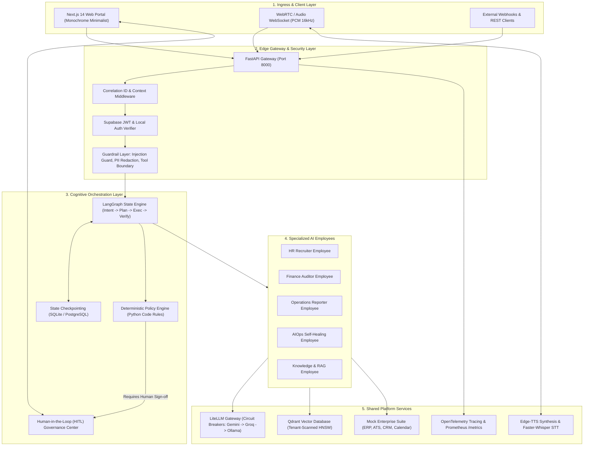
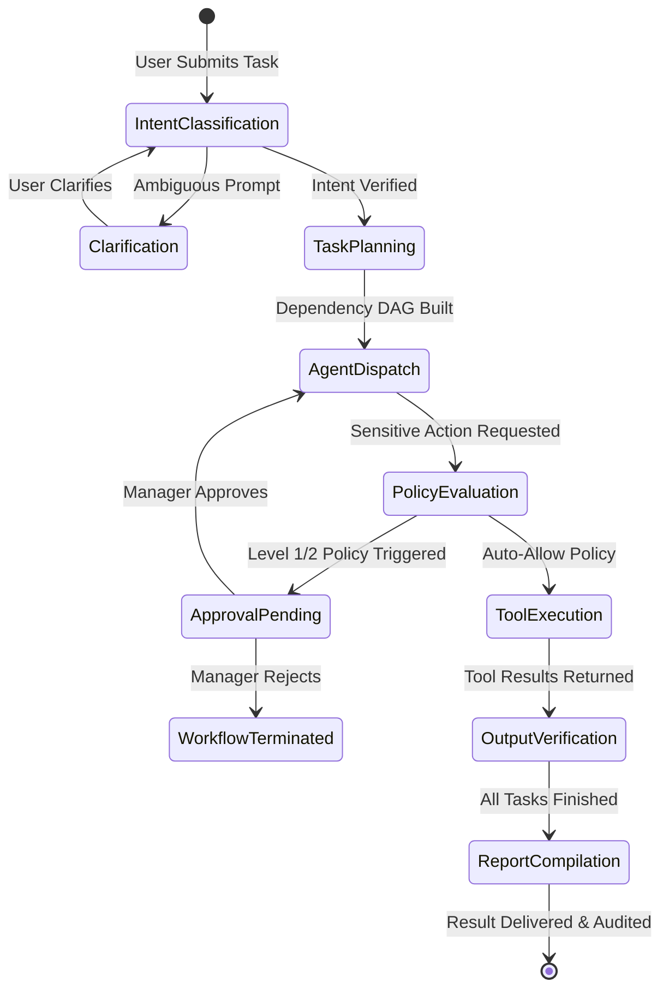
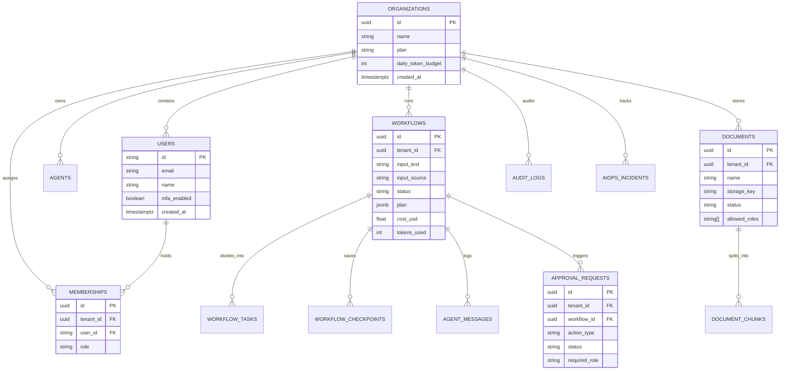
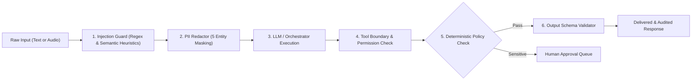
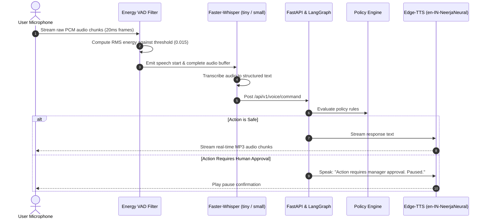

# AgentForce AI: Comprehensive Technical Architecture and System Design Specification

> **"Create AI Employees, Not AI Chatbots."** — The Enterprise Operating System for Governed AI Workforces.

---

## 1. Executive Summary & Architectural Mission

**AgentForce AI** is an enterprise-grade, multi-tenant SaaS platform and autonomous workforce orchestration system. Unlike conversational chatbots or unmoderated agent swarms, AgentForce AI deploys **purpose-built digital AI employees** across specialized corporate functions:
- **HR Talent Acquisition & Recruitment:** Resume parsing (PDF/DOCX), deterministic job description alignment, multi-criteria candidate scoring, and calendar scheduling governance.
- **Finance & Invoice Reconciliation:** 3-way Purchase Order (PO) matching, unit price/quantity variance detection, duplicate submission auditing, and payment authorization workflows.
- **Operations & Business Reporting:** Autonomous compilation of departmental KPIs from ERP warehouses, mathematical consistency verification, and PDF report generation.
- **AIOps Self-Healing Infrastructure:** Telemetry anomaly detection, error trace analysis, root-cause hypothesis generation, and governed incident remediation.

### The Five Inviolable Architectural Axioms
1. **Deterministic Governance:** Pure Python code rules govern sensitive tool executions. Silence, timeouts, or LLM hallucinations are **never** interpreted as authorization.
2. **Strict Multi-Tenancy:** Every database query, vector search, cache key, and telemetry span is partitioned by `tenant_id` derived securely from the authenticated identity, never from user-supplied request bodies.
3. **Centralized Orchestration:** Specialized agents never communicate directly with each other via unmoderated meshes. All coordination flows through the centralized **LangGraph Workforce Orchestrator** or the event bus.
4. **Idempotent Tool Execution:** All external actions (mock calendar, payment transactions, notification dispatches) require idempotency keys and are permanently recorded in immutable audit tables.
5. **Failover Resilience:** The LLM gateway uses circuit breakers with multi-provider fallbacks (`Google Gemini` &rarr; `Groq Cloud` &rarr; `Local Ollama`).

---

## 2. High-Level System Architecture & Ingress Flow



---

## 3. Cognitive Orchestration & State Machine Design

### 3.1 LangGraph Execution Pipeline
Multi-agent task execution follows a strict 5-stage sequential state graph:



1. **Intent Classification (`intent_node`):** Classifies requests into standard business categories (`hr.screen`, `finance.audit`, `ops.report`, `aiops.diagnose`) and extracts required metadata.
2. **Task Planning (`planner_node`):** Generates an ordered execution DAG with task dependencies, assigned employee types, and required tool permissions.
3. **Execution & Checkpointing (`orchestrator_node`):** Executes tasks in parallel or sequence based on the dependency graph. Before executing each step, state snapshots are written to `workflow_checkpoints`.
4. **Deterministic Policy Check (`policy_node`):** Intercepts tool calls before external execution:
   - Disbursements $> \$10,000$ &rarr; Requires dual Finance Manager sign-off (`payment.execute`).
   - Candidate interview dispatches &rarr; Requires HR Manager approval (`interview.schedule`).
   - Infrastructure modifications &rarr; Requires Ops/Admin sign-off (`system.remediate`).
5. **Output Verification (`verifier_node`):** Validates that outputs match expected Pydantic schemas, strips unintended hallucinated data, and compiles final user-facing responses.

### 3.2 State Checkpoint & Resumption Mechanics
Workflows pause when entering the `waiting_approval` status:
- The full execution frame is serialized to JSON and stored in `workflow_checkpoints` along with an incremented `step` integer.
- The workflow state transitions cleanly to `waiting_approval`.
- When an authorized manager posts to `/api/v1/approvals/{id}/decide`:
  1. The approval record updates to `approved`.
  2. An audit log entry is written with the decider's `user_id` and timestamp.
  3. The orchestrator rehydrates the execution state from the latest checkpoint and resumes execution seamlessly.

---

## 4. Multi-Tenant Relational & Vector Data Model

### 4.1 Entity-Relationship Diagram



### 4.2 Comprehensive Database Table Catalog (20 Tables)

| # | Table Name | Purpose | Primary Keys & Essential Foreign Keys |
|---|---|---|---|
| 1 | `organizations` | Multi-tenant workspace partitions and token allowances | `id` (UUID) |
| 2 | `users` | User identity records (compatible with Supabase & local auth) | `id` (String UUID) |
| 3 | `memberships` | Role-Based Access Control mapping (user &harr; tenant &harr; role) | `id` (UUID), `tenant_id` &rarr; `organizations.id`, `user_id` &rarr; `users.id` |
| 4 | `api_keys` | Programmatic API access keys with scoped permissions | `id` (UUID), `tenant_id` &rarr; `organizations.id` |
| 5 | `agents` | AI Employee runtime instances installed in tenant workspace | `id` (UUID), `tenant_id` &rarr; `organizations.id` |
| 6 | `agent_templates` | Marketplace catalog of pre-configured employee archetypes | `id` (UUID) |
| 7 | `workflows` | High-level workflow execution records and lifecycle states | `id` (UUID), `tenant_id` &rarr; `organizations.id` |
| 8 | `workflow_tasks` | Granular sub-tasks assigned to specific AI employees | `id` (UUID), `workflow_id` &rarr; `workflows.id`, `tenant_id` |
| 9 | `workflow_checkpoints` | Serialized LangGraph state frames for HITL pauses and recovery | `id` (UUID), `workflow_id` &rarr; `workflows.id` |
| 10 | `agent_messages` | Immutable record of inter-agent messages passed through orchestrator | `id` (UUID), `workflow_id` &rarr; `workflows.id`, `tenant_id` |
| 11 | `approval_requests` | Human-in-the-Loop governance requests for sensitive actions | `id` (UUID), `workflow_id` &rarr; `workflows.id`, `tenant_id` |
| 12 | `policy_rules` | Deterministic rules specifying required roles and approval triggers | `id` (UUID), `tenant_id` &rarr; `organizations.id` |
| 13 | `integrations` | Mock and enterprise connector configurations | `id` (UUID), `tenant_id` &rarr; `organizations.id` |
| 14 | `tool_executions` | Idempotent log of external tool actions with parameter redaction | `id` (UUID), `workflow_id` &rarr; `workflows.id`, `tenant_id` |
| 15 | `documents` | Document registry for ingested policies, resumes, and reports | `id` (UUID), `tenant_id` &rarr; `organizations.id` |
| 16 | `document_chunks` | Text chunks with vector references to Qdrant points | `id` (UUID), `document_id` &rarr; `documents.id`, `tenant_id` |
| 17 | `llm_requests` | Detailed cost, latency, token, and provider telemetry logs | `id` (UUID), `tenant_id` &rarr; `organizations.id`, `workflow_id` |
| 18 | `audit_logs` | RFC 4180 compliant, append-only compliance audit trail | `id` (UUID), `tenant_id` &rarr; `organizations.id` |
| 19 | `outbox_events` | Outbox pattern table for transactional event bus publishing | `id` (UUID), `tenant_id` &rarr; `organizations.id` |
| 20 | `aiops_incidents` | Tracked infrastructure incidents, root causes, and remediation | `id` (UUID), `tenant_id` &rarr; `organizations.id` |

### 4.3 Vector Memory & Hybrid RAG Architecture
- **Vector Database:** Qdrant collection `knowledge`.
- **Chunking Pipeline:** Overlapping fixed token window (500–800 tokens, 80-token overlap).
- **Mandatory Security Filter:**
  ```python
  filter = models.Filter(
      must=[
          models.FieldCondition(key="tenant_id", match=models.MatchValue(value=str(tenant_id))),
          models.FieldCondition(key="allowed_roles", match=models.MatchAny(any=[user_role, "member"])),
      ]
  )
  ```
  Any vector query lacking `tenant_id` filtering is strictly rejected at the service layer.

---

## 5. LLM Gateway & Resiliency Engineering

### 5.1 Multi-Tier Routing & Fallback Matrix
The LLM Gateway dynamically routes requests based on task criticality and confidentiality:

| Task Type | Primary Route (Tier 1) | Secondary Fallback (Tier 2) | Local Offline Fallback (Tier 3) |
|---|---|---|---|
| `INTENT` | `groq/llama-3.1-8b-instant` | `gemini/gemini-1.5-flash` | `ollama/llama3.1` |
| `PLANNING` | `gemini/gemini-1.5-pro` | `gemini/gemini-1.5-flash` | `ollama/llama3.1` |
| `SENSITIVE` | `ollama/llama3.1` *(Strictly local)* | None *(Isolated)* | None *(No cloud egress)* |
| `GENERAL` | `gemini/gemini-1.5-flash` | `groq/llama-3.1-8b-instant` | `ollama/llama3.1` |

### 5.2 3-State Circuit Breaker State Machine
Every provider/model combination is wrapped in an independent `CircuitBreaker`:
- **`CLOSED` (Normal):** Requests execute through the model. Consecutive failures increment a counter.
- **`OPEN` (Tripped):** After 3 consecutive failures, the circuit trips. Requests immediately skip to the next fallback tier without waiting for timeouts.
- **`HALF_OPEN` (Probe):** After a 30-second cooldown, a single probe request is allowed. A success resets the breaker to `CLOSED`; a failure trips it back to `OPEN`.

---

## 6. Security Guardrails & Enterprise Governance



### 6.1 Input Injection Guard
Scans prompts for system bypass attempts, role hijacking, instruction delimiters (`[SYSTEM]`, `<prompt_injection>`), and jailbreaks. Adversarial inputs are stripped or rejected with a `400 Bad Request` and logged in `audit_logs` as security incidents.

### 6.2 5-Entity PII Redaction Engine
Prior to logging, telemetry export, or prompt transmission, text passes through the PII masking engine:
- **Email:** `[REDACTED_EMAIL]`
- **Phone Numbers:** `[REDACTED_PHONE]`
- **SSN / National IDs:** `[REDACTED_SSN]`
- **Credit / Debit Cards:** `[REDACTED_CARD]`
- **API Keys / Auth Tokens:** `[REDACTED_KEY]`

### 6.3 Role-Based Access Control (RBAC) Matrix

| Operation | `owner` | `manager` | `approver` | `member` | `auditor` |
|---|:---:|:---:|:---:|:---:|:---:|
| Update Organization Settings & Token Budget |  |  |  |  |  |
| Invite / Remove Team Members |  |  |  |  |  |
| Authorize Financial Disbursements ($> \$10,000$) |  |  |  |  |  |
| Authorize Candidate Interview Invites |  |  |  |  |  |
| Authorize AIOps Infrastructure Remediation |  |  |  |  |  |
| Submit Workflows & Run Voice Commands |  |  |  |  |  |
| Search Knowledge Base & RAG |  |  |  |  |  |
| View & Export Compliance Audit Logs (CSV) |  |  |  |  |  |

---

## 7. Real-Time Voice AI Subsystem

AgentForce AI includes a production-grade, zero-cloud-cost Voice AI engine:



### Voice Pipeline Highlights
- **VAD Energy Gating:** Computes Root Mean Square (RMS) energy per 20ms audio frame with a 400ms silence hangover window.
- **Local STT (Faster-Whisper):** Uses CTranslate2-accelerated Whisper models (`tiny`/`small`) running locally on CPU in INT8 quantization with zero network latency.
- **Edge-TTS Neural Synthesis:** Streams natural speech using `en-IN-NeerjaNeural` or `en-US-JennyNeural` via chunked MP3 transfer encoding.
- **Barge-in / Interrupt Support:** Incoming user speech immediately trips a `cancel_event` that halts TTS audio generation and resets session context.

---

## 8. Frontend Architecture & Design System

The frontend is built on **Next.js 14 App Router** using TypeScript, Tailwind CSS, and Lucide icons.

### 8.1 Monochrome Minimalist Design System
In accordance with enterprise operational ergonomics:
- **Palette:** High-contrast neutral palette (`bg-background`, `text-foreground`, `border-border`, `bg-card`, `bg-muted`). Zero bright saturated hues except subtle functional alerts (`text-danger`, `text-success`).
- **Typography:** Inter / system monospace sans-serif with strict tracking and leading.
- **Components:** Compact density, square/subtle borders (`rounded-md`, `rounded-lg`), zero heavy drop shadows, zero multi-color gradients.
- **Dark/Light Mode:** Native CSS variables toggled dynamically with `next-themes` and persisted in `localStorage`.

### 8.2 Real-Time Workflow Timeline (SSE)
- Workflows connect to `/api/v1/workflows/{id}/events` via Server-Sent Events (SSE).
- Agents emit live event frames (`task.started`, `task.progress`, `approval.required`, `workflow.completed`).
- Timeline components render execution graphs, cost tracking, and token burn rates in real time.

---

## 9. Observability, Telemetry & AIOps

### 9.1 Metrics & Telemetry Stack
- **Prometheus Metrics (`/metrics`):** Exposes counters and histograms for:
  - `agentforce_workflow_executions_total{status, tenant_id}`
  - `agentforce_agent_task_executions_total{agent, status}`
  - `agentforce_llm_requests_total{provider, model, status}`
  - `agentforce_llm_tokens_total{type, provider, model}`
  - `agentforce_llm_cost_usd_total{provider, model}`
  - `agentforce_aiops_incidents_total{severity}`
- **OpenTelemetry Distributed Tracing:** Instrumenting FastAPI requests with custom span processors, tracing each workflow through intent, planning, agent tasks, and tool calls.
- **In-Memory Span Ring Buffer:** Provides instant trace inspection at `/api/v1/analytics/traces` without requiring an external Jaeger/OTel backend for local development.

### 9.2 AIOps Autonomous Incident Remediation
- When integrations or worker queues fail (e.g., ATS adapter socket timeout, ERP database connection pool exhaustion), the AIOps monitor detects error bursts.
- An incident is automatically opened in `aiops_incidents` with:
  - Error frequency and affected tenant.
  - Root-cause hypothesis generated from error traces.
  - Recommended remediation action.
- The remediation plan is submitted as a Level-2 Approval request. Once confirmed by a Manager or Owner, the healing script executes autonomously and marks the incident `resolved`.

---

## 10. Complete REST API Contract Directory

### Auth & Workspace Management
- `POST /api/v1/auth/register` &mdash; Create a new user profile and organization workspace locally.
- `POST /api/v1/auth/demo-login` &mdash; Instant 1-click login for pre-seeded enterprise personas.
- `GET /api/v1/me` &mdash; Fetch active profile, tenant memberships, and assigned roles.
- `GET /api/v1/org/members` &mdash; List all members and assigned RBAC roles for the active tenant.
- `POST /api/v1/org/members/invitations` &mdash; Invite a new user with a designated role (`manager`, `member`, etc.).
- `PATCH /api/v1/org/members/{id}/role` &mdash; Elevate or demote member authority (Owner only).

### Workflows & Cognitive Execution
- `POST /api/v1/workflows` &mdash; Submit a natural language task for autonomous agent execution.
- `GET /api/v1/workflows` &mdash; List tenant workflows filtered by status (`running`, `waiting_approval`, `completed`).
- `GET /api/v1/workflows/{id}` &mdash; Fetch complete workflow status, execution DAG, cost, and task outputs.
- `GET /api/v1/workflows/{id}/events` &mdash; Server-Sent Events (SSE) streaming real-time execution timeline.
- `POST /api/v1/workflows/{id}/cancel` &mdash; Terminate an active workflow execution.

### Governance & Approvals Center
- `GET /api/v1/approvals` &mdash; List pending and historical human-in-the-loop approval requests.
- `POST /api/v1/approvals/{id}/decide` &mdash; Approve or reject a sensitive agent action with audit notes.

### AI Employee Marketplace
- `GET /api/v1/marketplace/templates` &mdash; Browse available AI Employee templates (HR, Finance, Ops, AIOps).
- `POST /api/v1/marketplace/templates/{id}/install` &mdash; Deploy an AI Employee into the active tenant workspace.
- `GET /api/v1/agents` &mdash; List active digital employees installed in the organization roster.

### Knowledge Base & Vector Memory
- `POST /api/v1/documents` &mdash; Upload policies, manuals, or resumes for chunking and Qdrant ingestion.
- `GET /api/v1/documents` &mdash; List ingested tenant documents and chunk statistics.
- `POST /api/v1/knowledge/search` &mdash; Semantic vector search with tenant and role isolation.

### Voice AI
- `POST /api/v1/voice/command` &mdash; End-to-end spoken workflow execution (STT &rarr; LangGraph &rarr; TTS).
- `POST /api/v1/voice/synthesize` &mdash; High-performance neural text-to-speech MP3 audio synthesis.

### Compliance & Auditing
- `GET /api/v1/audit-logs` &mdash; Query immutable audit records filtered by actor, action, or date range.
- `GET /api/v1/audit-logs/export` &mdash; Stream RFC 4180-compliant CSV audit export for regulatory auditors.

### Health & Telemetry
- `GET /health` &mdash; Health probe returning service readiness and correlation headers.
- `GET /ready` &mdash; Readiness probe verifying database and vector store connectivity.
- `GET /metrics` &mdash; Prometheus operational exposition endpoint.

---

## 11. Verification & Test Suite Summary

The backend includes a comprehensive **71-test integration suite** ([backend/tests/run_tests.py](file:///d:/AI-Workforce-Project-main/backend/tests/run_tests.py)) covering all 10 project phases:
- **Phase 0 & 1:** Health probes, correlation propagation, JWT verification, and multi-tenant isolation.
- **Phase 2:** LiteLLM gateway, 3-tier circuit breakers, and automatic fallbacks.
- **Phase 3:** LangGraph state machine, state checkpointing, and real-time SSE event streaming.
- **Phase 4:** Document chunking, Qdrant vector memory, and role-filtered RAG search.
- **Phase 5:** Deterministic policy engine, human-in-the-loop approvals, and double-approval prevention.
- **Phase 6:** Finance 3-way PO matching, duplicate invoice detection, and operations KPI calculation.
- **Phase 7:** Direct/indirect prompt injection defense, 5-entity PII redaction, and tool bounds validation.
- **Phase 8:** VAD energy detection, Faster-Whisper STT parsing, Edge-TTS audio streaming, and voice interrupts.
- **Phase 9:** OpenTelemetry distributed tracing, Prometheus metrics exposition, and AIOps self-healing.
- **Phase 10:** AI Employee marketplace installation, audit trail filtering, RFC 4180 CSV export, and 3-minute executive demo verification.

**Test Status:** `71 / 71 PASSED (100% SUCCESS RATE)`
